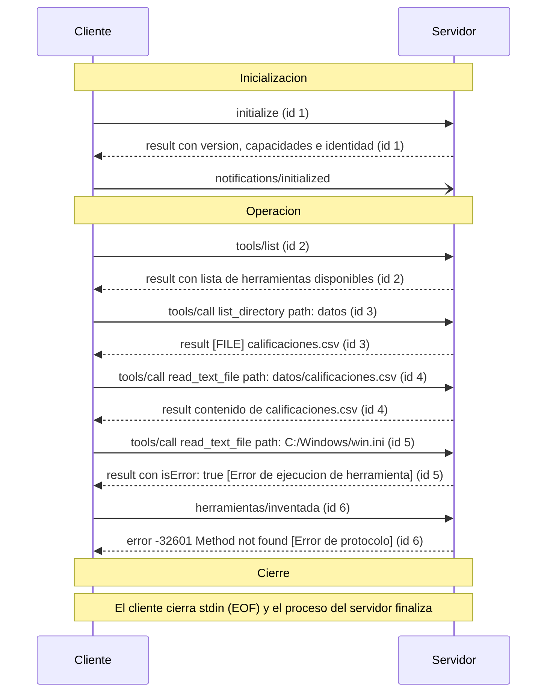

# Práctica 2: El Protocolo Model Context Protocol (MCP) a Bajo Nivel

## 1. Descripción

Esta práctica profundiza en el funcionamiento interno del **Model Context Protocol (MCP)** implementando y analizando la comunicación cliente-servidor a bajo nivel mediante el transporte estándar `stdio` y mensajes formateados bajo la especificación **JSON-RPC 2.0**.

A través de esta práctica se explora cómo un cliente se conecta directamente a un servidor MCP (`@modelcontextprotocol/server-filesystem`), gestiona el ciclo de vida del protocolo (fases de negociación, inicialización y notificación), lista herramientas, invoca ejecuciones y maneja las distintas categorías de respuestas y errores que el estándar contempla.

* **Materia:** Desarrollo de Agentes Inteligentes (ACD-2504).
* **Entorno operativo:** Windows 11 (x64) con Node.js v24.22.1 y npm/npx v11.19.1.
* **Servidor MCP evaluado:** `@modelcontextprotocol/server-filesystem` (v2.3.0).
* **Transporte:** `stdio` (comunicación interproceso mediante entrada y salida estándar en formato JSON delimitado por saltos de línea).

---

## 2. Estructura del Proyecto

```text
practica2-mcp/
├── cliente_mcp.mjs          # Cliente MCP mínimo en Node.js sin dependencias externas
├── mcp.json                 # Configuración del servidor filesystem para clientes compatibles
├── README.md                # Documentación técnica y análisis comparativo de errores
├── datos/
│   └── calificaciones.csv   # Dataset de prueba para lectura de archivos
├── evidencias/              # Capturas de pantalla de la inspección con MCP Inspector (Actividad A)
│   ├── Captura de pantalla 2026-11-11 094738.png
│   ├── Captura de pantalla 2026-11-11 095019.png
│   ├── Captura de pantalla 2026-11-11 095444.png
│   ├── Captura de pantalla 2026-11-11 095513.png
│   └── Captura de pantalla 2026-11-11 095828.png
└── salida/
    ├── historial_inspector.json # Registro de mensajes exportado desde MCP Inspector
    └── traza.jsonl              # Traza completa de la conversación generada por cliente_mcp.mjs (13 mensajes)
```

---

## 3. Arquitectura del Cliente Mínimo (`cliente_mcp.mjs`)

El cliente implementado en `cliente_mcp.mjs` no requiere librerías externas y opera directamente sobre los módulos nativos de Node.js (`child_process`, `readline`, `fs`):

1. **Lanzamiento del servidor (`spawn`):** Inicia el servidor `npx -y @modelcontextprotocol/server-filesystem .` como proceso hijo con canales de entrada y salida tubería (`stdio: ['pipe', 'pipe', 'inherit']`).
2. **Serialización y envío JSON-RPC:**
   - `solicitar(method, params)`: Asigna un identificador incremental `id`, envía el mensaje con `"jsonrpc": "2.0"` a `stdin` y guarda una promesa en un mapa de pendientes.
   - `notificar(method)`: Envía un mensaje unidireccional sin campo `id`, el cual no espera respuesta del servidor.
3. **Recepción y procesamiento asíncrono:** Lee la salida `stdout` línea por línea mediante `readline`, deserializa el JSON, lo registra en `salida/traza.jsonl` y resuelve la promesa correspondiente al `id` del mensaje.
4. **Cierre de conexión:** Envía `EOF` a la entrada del servidor (`servidor.stdin.end()`), finalizando ordenadamente el subproceso.

---

## 4. Actividad C: Análisis de Respuestas y Diferenciación de Errores

En la **Actividad C**, se modificó la conversación del cliente agregando tres solicitudes antes del cierre del servidor (paso 5):
1. **Lectura correcta:** Llamada a `tools/call` con la herramienta `read_text_file` sobre `datos/calificaciones.csv`.
2. **Lectura prohibida:** Llamada a `tools/call` con `read_text_file` sobre una ruta externa al directorio delimitado (`C:/Windows/win.ini`).
3. **Método inexistente:** Envío de una solicitud con un método JSON-RPC no registrado en el servidor (`herramientas/inventada`).

La ejecución del cliente produjo un total de **13 mensajes** en `salida/traza.jsonl`. A continuación se analizan en detalle las dos solicitudes que fallaron.

---

### 4.1 Respuestas Fallidas (Copiadas Textualmente de la Traza)

#### Respuesta 1: Lectura fuera del directorio permitido (ID 5)

* **Solicitud enviada (Línea 10 de `salida/traza.jsonl`):**
```json
{"direccion":"CLIENTE -> SERVIDOR","mensaje":{"jsonrpc":"2.0","id":5,"method":"tools/call","params":{"name":"read_text_file","arguments":{"path":"C:/Windows/win.ini"}}}}
```

* **Respuesta recibida del servidor (Línea 11 de `salida/traza.jsonl`):**
```json
{"direccion":"SERVIDOR -> CLIENTE","mensaje":{"result":{"content":[{"type":"text","text":"Access denied - path outside allowed directories: C:\\Windows\\win.ini not in C:\\AgentesInt\\practica2-mcp"}],"isError":true},"jsonrpc":"2.0","id":5}}
```

En formato legible:
```json
{
  "jsonrpc": "2.0",
  "id": 5,
  "result": {
    "content": [
      {
        "type": "text",
        "text": "Access denied - path outside allowed directories: C:\\Windows\\win.ini not in C:\\AgentesInt\\practica2-mcp"
      }
    ],
    "isError": true
  }
}
```

---

#### Respuesta 2: Método RPC no existente (ID 6)

* **Solicitud enviada (Línea 12 de `salida/traza.jsonl`):**
```json
{"direccion":"CLIENTE -> SERVIDOR","mensaje":{"jsonrpc":"2.0","id":6,"method":"herramientas/inventada","params":{}}}
```

* **Respuesta recibida del servidor (Línea 13 de `salida/traza.jsonl`):**
```json
{"direccion":"SERVIDOR -> CLIENTE","mensaje":{"jsonrpc":"2.0","id":6,"error":{"code":-32601,"message":"Method not found"}}}
```

En formato legible:
```json
{
  "jsonrpc": "2.0",
  "id": 6,
  "error": {
    "code": -32601,
    "message": "Method not found"
  }
}
```

---

### 4.2 Explicación y Diferenciación Técnica de los Errores

| Criterio | Solicitud 2 (Lectura prohibida - ID 5) | Solicitud 3 (Método inventado - ID 6) |
| :--- | :--- | :--- |
| **Categoría del error** | **Error de ejecución de herramienta** (*Tool Execution Error*) | **Error de protocolo** (*Protocol / JSON-RPC Error*) |
| **Capa donde ocurre** | **Capa de aplicación / lógica de negocio** del servidor MCP | **Capa de transporte / enrutamiento** JSON-RPC 2.0 |
| **Estado a nivel JSON-RPC** | **Éxito (200 OK equivalente)**: La transacción RPC se completó normalmente | **Fallo**: La transacción RPC no se pudo resolver ni enrutar |
| **Estructura raíz de la respuesta** | Contiene el objeto `"result"` (no existe `"error"`) | Contiene el objeto `"error"` (no existe `"result"`) |
| **Campos distintivos** | `"isError": true` y `"content"` dentro de `"result"` | `"code": -32601` y `"message": "Method not found"` dentro de `"error"` |
| **Causa del fallo** | La herramienta `read_text_file` validó que la ruta solicitada (`C:/Windows/win.ini`) viola la política de contención (*allowed directories*) del servidor | El despachador RPC del servidor no tiene ninguna función o manejador registrado para el método `herramientas/inventada` |
| **Significado para un agente inteligente** | El agente puede leer el texto en `content` para comprender por qué falló su acción e intentar una ruta válida o una alternativa | El cliente/agente envió un comando inválido que rompe la especificación del protocolo; debe corregir el método invocado |

---

### 4.3 Análisis de los Campos de Reconocimiento

#### ¿En qué campos se reconoció el Error de Ejecución de Herramienta (ID 5)?
1. **Presencia de `"result"` y ausencia de `"error"` a nivel raíz:** Para el protocolo JSON-RPC, el servidor procesó exitosamente la solicitud. La llamada al método `tools/call` fue recibida, comprendida y atendida.
2. **Campo `"isError": true` dentro de `"result"`:** Es el estándar definido por la especificación de MCP para indicar que la herramienta no pudo cumplir su objetivo. A diferencia de una excepción que tumbaría el canal de comunicación, MCP modela los fallos de herramientas como respuestas válidas que informan el error al cliente o modelo.
3. **Campo `"content"` dentro de `"result"`:** Alberga un bloque de tipo `"text"` con el mensaje `"Access denied - path outside allowed directories: C:\\Windows\\win.ini not in C:\\AgentesInt\\practica2-mcp"`. Este contenido permite a un modelo de lenguaje o agente razonar sobre el motivo del rechazo sin que falle la infraestructura de comunicación.

#### ¿En qué campos se reconoció el Error de Protocolo (ID 6)?
1. **Presencia de `"error"` a nivel raíz:** La respuesta carece por completo del campo `"result"`. La especificación JSON-RPC 2.0 estipula que una respuesta debe contener exclusivamente `"result"` o `"error"`, nunca ambos.
2. **Campo `"error.code": -32601`:** Es el código numérico reservado estándar en la especificación JSON-RPC 2.0 para `Method not found` (Método no encontrado). Indica un fallo en el protocolo de comunicación antes de que cualquier lógica de negocio o herramienta sea invocada.
3. **Campo `"error.message": "Method not found"`:** Cadena textual estándar que documenta el fallo sintáctico o semántico de la solicitud RPC enviada por el cliente.

---

## 5. Actividad D: Comparación de Dos Clientes MCP

En esta actividad se comparó el proceso de inicialización (`initialize`) y negociación de protocolo de dos clientes distintos conectados contra el mismo servidor (`@modelcontextprotocol/server-filesystem`):
* **MCP Inspector (`salida/historial_inspector.json`)**: Cliente interactivo de diagnóstico oficial de MCP.
* **Cliente mínimo (`salida/traza.jsonl`)**: Cliente ligero implementado en Node.js sobre `stdio`.

---

### 5.1 Tabla Comparativa de Inicialización

| Característica / Campo | Inspector (`historial_inspector.json`) | Cliente mínimo (`traza.jsonl`) |
| :--- | :--- | :--- |
| **Nombre y versión del cliente (`clientInfo`)** | `mcp-inspector` v2.14.0 | `cliente-minimo` v1.0.0 |
| **Versión del protocolo que propuso el cliente** | `2025-11-25` | `2025-06-18` |
| **Versión del protocolo que respondió el servidor** | `2025-11-25` | `2025-06-18` |
| **Capacidades que declaró el cliente (`capabilities`)** | Declaró múltiples capacidades avanzadas:<br>• `roots: { listChanged: true }`<br>• `sampling: {}`<br>• `elicitation: { form: {}, url: {} }`<br>• `tasks: { list: {}, cancel: {}, requests: { sampling: {}, elicitation: {} } }`<br>• `extensions: { ... }` | Objeto vacío (`{}`): No declaró ninguna capacidad especial. |
| **¿El servidor envió una solicitud al cliente? ¿Cuál?** | **Sí**. Envió la solicitud con método `"roots/list"` e `id: 0`. | **No**. El servidor no envió ninguna solicitud al cliente. |

---

### 5.2 Explicación de por qué el Servidor se Comportó Distinto con Cada Cliente

El comportamiento diferenciado del servidor responde a los principios de diseño del **Model Context Protocol**:

1. **Invocación bidireccional y negociación de capacidades (`roots/list`):**
   * El protocolo MCP sobre `stdio` es **completamente bidireccional**: el servidor no solo responde a las solicitudes del cliente, sino que también puede actuar como emisor de solicitudes hacia el cliente si éste declara soportarlas.
   * En el caso del **Inspector**, el cliente declaró la capacidad `"roots": { "listChanged": true }`. Esto le indica formalmente al servidor de sistema de archivos que el cliente gestiona dinámicamente las carpetas permitidas de trabajo (*roots*). En consecuencia, inmediatamente después de recibir la notificación `notifications/initialized`, el servidor envió al Inspector la solicitud inversa `roots/list` (id: 0) para consultar qué directorios raíz estaban autorizados.
   * En el caso del **Cliente mínimo**, el campo de capacidades fue un objeto vacío (`capabilities: {}`). Al no declarar soporte para `roots`, el servidor emitió el mensaje informativo interno:  
     `Client does not support MCP Roots, using allowed directories set from server args: [ 'C:\AgentesInt\practica2-mcp' ]`.  
     Por este motivo, el servidor se abstuvo de enviar la solicitud `roots/list` y utilizó directamente la ruta pasada como argumento de línea de comandos en su inicio.

2. **Negociación retrocompatible de versión (`protocolVersion`):**
   * El Inspector propuso `2025-11-25` y el cliente mínimo propuso `2025-06-18`.
   * El servidor `@modelcontextprotocol/server-filesystem` soporta ambas especificaciones; por tanto, en ambos casos acordó operar con la versión exacta que cada cliente propuso, garantizando retrocompatibilidad con clientes anteriores y aprovechamiento de características modernas con clientes recientes.

---

### 5.3 Experimento con Versión Inexistente (`protocolVersion: '1999-01-01'`)

Para observar el mecanismo de negociación ante versiones no compatibles, se modificó temporalmente `cliente_mcp.mjs` proponiendo una versión inexistente:

```javascript
await solicitar('initialize', {
  protocolVersion: '1999-01-01',
  capabilities: {},
  clientInfo: { name: 'cliente-minimo', version: '1.0.0' },
});
```

#### Resultado Observado:
* **Versión propuesta por el cliente:** `'1999-01-01'`
* **Versión respondida por el servidor:** `'2025-11-25'`

```json
{
  "jsonrpc": "2.0",
  "id": 1,
  "result": {
    "protocolVersion": "2025-11-25",
    "capabilities": {
      "tools": { "listChanged": true },
      "resources": { "listChanged": true }
    },
    "serverInfo": {
      "name": "secure-filesystem-server",
      "version": "2.3.0"
    }
  }
}
```

#### Explicación Técnica del Experimento:
El servidor MCP **no interrumpe la conexión ni arroja un error de protocolo** cuando el cliente solicita una versión desconocida. Siguiendo la especificación estándar de MCP, cuando el cliente propone una versión que el servidor no soporta, el servidor responde con la versión más reciente o más alta que tiene implementada (en este caso, `2025-11-25`). 

A partir de esa respuesta, el cliente es el responsable de evaluar si la versión devuelta por el servidor le es compatible para continuar la conversación o si debe cerrar el canal de comunicación.

> **Restauración:** Concluida la prueba, se restauró el valor original `protocolVersion: '2025-06-18'` en `cliente_mcp.mjs` y se ejecutó nuevamente el cliente, asegurando que la traza en `salida/traza.jsonl` mantenga intactos los 13 mensajes correspondientes a la Actividad C.

---

## 6. Actividad E: Diagrama de Secuencia de la Sesión Completa

A continuación se presenta el diagrama de secuencia en formato Mermaid que modela la sesión completa del cliente mínimo (`cliente_mcp.mjs`) contra el servidor de sistema de archivos MCP, tal como quedó registrada en `salida/traza.jsonl` (13 mensajes divididos en tres fases: inicialización, operación y cierre):



### Detalle de las Fases del Diagrama

1. **Fase de Inicialización:**
   * **Mensaje 1 (`C->>S`):** Solicitud `initialize` (id 1) proponiendo la versión de protocolo `2025-06-18` y capacidades vacías `{}`.
   * **Mensaje 2 (`S-->>C`):** Respuesta exitosa `result` (id 1) del servidor confirmando la versión `2025-06-18`, sus capacidades y su identidad (`secure-filesystem-server`).
   * **Mensaje 3 (`C-)S`):** Notificación unidireccional `notifications/initialized` (sin id) que da por concluida la negociación.

2. **Fase de Operación:**
   * **Mensaje 4 (`C->>S`):** Solicitud `tools/list` (id 2) para descubrir las herramientas ofrecidas por el servidor.
   * **Mensaje 5 (`S-->>C`):** Respuesta `result` (id 2) con el catálogo completo de herramientas (`read_text_file`, `list_directory`, etc.).
   * **Mensaje 6 (`C->>S`):** Solicitud `tools/call` (id 3) ejecutando `list_directory` sobre la carpeta `datos`.
   * **Mensaje 7 (`S-->>C`):** Respuesta `result` (id 3) listando el archivo `[FILE] calificaciones.csv`.
   * **Mensaje 8 (`C->>S`):** Solicitud `tools/call` (id 4) ejecutando `read_text_file` sobre `datos/calificaciones.csv`.
   * **Mensaje 9 (`S-->>C`):** Respuesta `result` (id 4) devolviendo el texto plano del archivo CSV.
   * **Mensaje 10 (`C->>S`):** Solicitud `tools/call` (id 5) intentando leer `C:/Windows/win.ini`.
   * **Mensaje 11 (`S-->>C`):** Respuesta con `"result"` e `"isError": true` (**Error de ejecución de herramienta**) por violación de contención de directorio.
   * **Mensaje 12 (`C->>S`):** Solicitud con método inexistente `herramientas/inventada` (id 6).
   * **Mensaje 13 (`S-->>C`):** Respuesta con `"error"` y código `-32601` (**Error de protocolo**) al no existir el método solicitado.

3. **Fase de Cierre:**
   * El cliente ejecuta `servidor.stdin.end()`, cerrando el flujo de entrada estándar (`EOF`). Al no tener más datos por procesar, el subproceso del servidor finaliza ordenadamente.

---

## 7. Reproducción y Ejecución

Para ejecutar el cliente y regenerar la traza:

```bash
node cliente_mcp.mjs
```

El resultado en consola mostrará el intercambio completo de los 13 mensajes, guardándose simultáneamente en `salida/traza.jsonl`.
