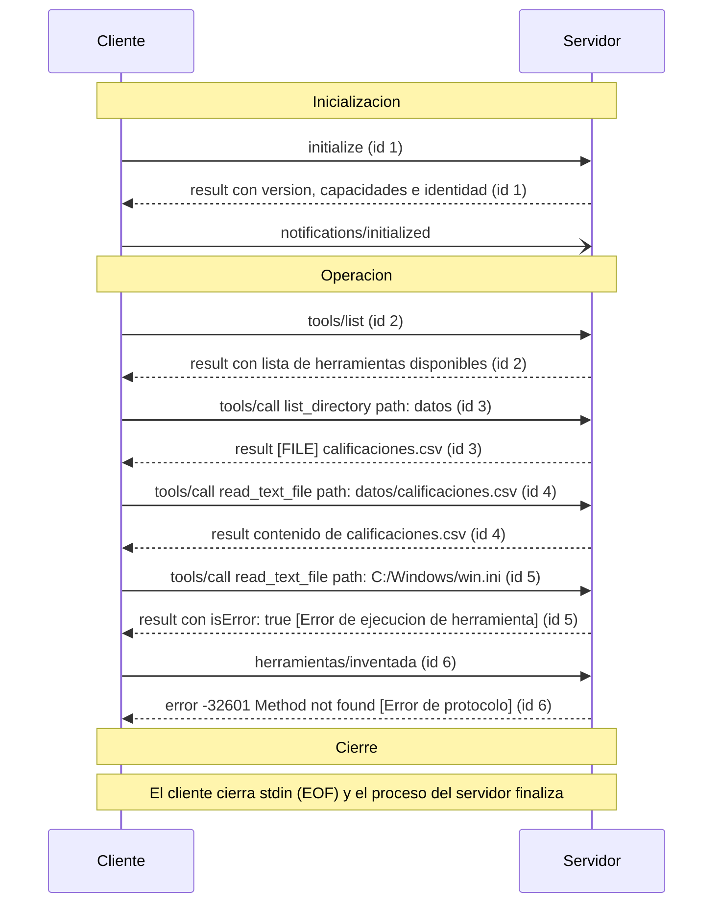

# Práctica 2: El Protocolo Model Context Protocol (MCP) a Bajo Nivel

## 1. Descripción

Esta práctica consiste en el análisis, implementación y evaluación experimental del **Model Context Protocol (MCP)** a bajo nivel. A diferencia de implementaciones de alto nivel donde librerías o SDKs ocultan los detalles del canal, aquí se examina de manera directa el intercambio de mensajes en formato **JSON-RPC 2.0** a través del transporte estándar **`stdio`** (entrada y salida estándar).

A lo largo de la práctica se interactúa con el servidor oficial de sistema de archivos de MCP, primero mediante la herramienta gráfica de diagnóstico **MCP Inspector** y posteriormente mediante la construcción y ejecución de un **cliente mínimo en Node.js sin dependencias**. Se analizan las etapas de negociación e inicialización, la invocación de herramientas, el manejo de errores en distintas capas arquitectónicas y la bidireccionalidad del protocolo.

* **Materia:** Desarrollo de Agentes Inteligentes (ACD-2504).
* **Sistema operativo:** Windows 11 (x64) [versión 10.0.26100].
* **Versión de Node.js:** v24.22.1 (con npm/npx v11.19.1).
* **Versión del Inspector:** `@modelcontextprotocol/inspector` v2.14.0 (`mcp-inspector` v2.14.0).
* **Versión del servidor:** `@modelcontextprotocol/server-filesystem` v2.3.0 (`secure-filesystem-server` v2.3.0).

---

## 2. Requisitos y reproducción

### Requisitos del sistema
Para reproducir esta práctica desde cero en otra máquina se requiere:
1. **Node.js:** Versión 18.0 o superior (verificado y ejecutado sobre Node.js v24.22.1). Incluye `npx` y los módulos nativos requeridos (`node:child_process`, `node:readline`, `node:fs`).
2. **Git:** Para clonar el repositorio y gestionar el control de versiones.
3. **Conexión a Internet:** Para la primera ejecución de `npx`, que descarga bajo demanda los paquetes de MCP si no se encuentran en la caché local.

### Comandos para reproducir la práctica paso a paso

1. **Clonar el repositorio:**
   ```bash
   git clone https://github.com/Kath-V05/practica2-mcp.git
   cd practica2-mcp
   ```

2. **Reproducir la Actividad A (Inspección gráfica con MCP Inspector):**
   Ejecuta el Inspector conectándolo al servidor filesystem delimitado a la carpeta actual:
   ```bash
   npx @modelcontextprotocol/inspector npx -y @modelcontextprotocol/server-filesystem .
   ```
   Abre en el navegador la URL local indicada (por defecto `http://localhost:5173`), explora las herramientas y recursos disponibles, y exporta el historial en `salida/historial_inspector.json`.

3. **Reproducir las Actividades B y C (Cliente mínimo en Node.js):**
   Ejecuta el script del cliente MCP mínimo:
   ```bash
   node cliente_mcp.mjs
   ```
   El script iniciará el servidor como subproceso, ejecutará el ciclo de inicialización, descubrirá herramientas, invocará `list_directory`, realizará lecturas de prueba y finalizará el servidor enviando EOF a `stdin`.

4. **Verificar los resultados generados:**
   * Archivo de traza: [`salida/traza.jsonl`](./salida/traza.jsonl) debe contener exactamente **13 líneas** (13 mensajes JSON-RPC).
   * Verificación rápida en PowerShell:
     ```powershell
     Get-Content salida\traza.jsonl | Measure-Object -Line
     ```

---

## 3. Actividad A: Inspección con MCP Inspector

En la Actividad A se empleó la herramienta oficial `@modelcontextprotocol/inspector` para diagnosticar interactivamente el servidor de archivos. La sesión completa quedó guardada en el archivo [`salida/historial_inspector.json`](./salida/historial_inspector.json).

### Datos de la Inicialización
* **Cliente:** `mcp-inspector` versión `2.14.0`.
* **Protocolo propuesto por el cliente:** `2025-11-25`.
* **Servidor conectado:** `secure-filesystem-server` versión `2.3.0`.
* **Protocolo acordado por el servidor:** `2025-11-25`.
* **Capacidades declaradas por el cliente:** `roots` (con `listChanged: true`), `sampling`, `elicitation`, `tasks` y `extensions`.
* **Capacidades respondidas por el servidor:** `tools: { listChanged: true }`, `resources: { listChanged: true }`.

### Tabla de Mensajes del Inspector

A continuación se resume la secuencia completa de los 11 eventos registrados en [`salida/historial_inspector.json`](./salida/historial_inspector.json):

| # | Origen | Dirección | Método / Acción | ID | Resultado / Descripción |
| :-: | :--- | :--- | :--- | :-: | :--- |
| **1** | Cliente | Solicitud | `initialize` | `0` | Negociación de protocolo (`2025-11-25`), capacidades del Inspector y metadatos del cliente. |
| **2** | Servidor | Respuesta | `initialize` (response) | `0` | Servidor acepta versión `2025-11-25`, confirma identidad `secure-filesystem-server` y capacidades (`tools`, `resources`). |
| **3** | Cliente | Notificación | `notifications/initialized` | — | Cliente notifica que la fase de handshake ha concluido exitosamente. |
| **4** | Cliente | Solicitud | `resources/list` | `1` | Consulta la lista de recursos expuestos por el servidor (devuelve lista vacía `[]`). |
| **5** | Cliente | Solicitud | `tools/list` | `2` | Consulta el catálogo de herramientas disponibles (devuelve 14 herramientas de manipulación de archivos). |
| **6** | Cliente | Solicitud | `resources/templates/list` | `3` | Consulta plantillas de recursos registradas (devuelve lista vacía `[]`). |
| **7** | Servidor | Solicitud | `roots/list` | `0` | **Petición inversa del servidor al cliente**: consulta las raíces permitidas dado que el cliente declaró soportar `roots`. |
| **8** | Cliente | Respuesta | `roots/list` (response) | `0` | Inspector responde con la lista de directorios raíz autorizados. |
| **9** | Cliente | Solicitud | `tools/call` (`list_directory`) | `4` | Lista contenido de `C:\AgentesInt\practica2-mcp` (devuelve `.git`, `datos`, `evidencias`, `mcp.json`, `salida`). |
| **10** | Cliente | Solicitud | `tools/call` (`search_files`) | `5` | Búsqueda por patrón `.txt` en el workspace (devuelve `No matches found`). |
| **11** | Cliente | Solicitud | `tools/call` (`search_files`) | `6` | Búsqueda por patrón `*.txt` en el workspace (devuelve `No matches found`). |
| **12** | Cliente | Solicitud | `tools/call` (`write_file`) | `7` | Intento de escritura erróneo pasando ruta de directorio; falla con `isError: true` (`Refusing to write: not a regular file`). |
| **13** | Cliente | Solicitud | `tools/call` (`search_files`) | `8` | Búsqueda por patrón `*.ts` en el workspace (devuelve `No matches found`). |

### Capturas de Pantalla de la Evidencia

Las capturas tomadas durante la sesión con el Inspector se encuentran almacenadas en la carpeta [`evidencias/`](./evidencias/):

1. **Captura 1 — Inicialización e interfaz principal:**  
   
2. **Captura 2 — Conexión y capacidades:**  
   
3. **Captura 3 — Exploración de herramientas disponibles:**  
   
4. **Captura 4 — Ejecución de herramientas en tiempo real:**  
   
5. **Captura 5 — Historial de mensajes y traza de red:**  
   

---

## 4. Actividad B: Cliente MCP Mínimo

En la Actividad B se construyó el cliente [`cliente_mcp.mjs`](./cliente_mcp.mjs) en JavaScript moderno (ESM) para comunicarse directamente con el servidor a través de sus canales estándar `stdio`.

### Tabla de los Siete Mensajes Iniciales

La interacción inicial entre el cliente mínimo y el servidor produjo exactamente siete mensajes antes de incorporar las pruebas adicionales:

| Mensaje | Dirección | Objeto JSON-RPC / Método | ID | Significado y Propósito |
| :-: | :--- | :--- | :-: | :--- |
| **1** | `CLIENTE -> SERVIDOR` | `{"method": "initialize", "params": {...}}` | `1` | El cliente inicia la sesión, propone versión de protocolo `2025-06-18`, capacidades vacías `{}` y se identifica como `cliente-minimo` v1.0.0. |
| **2** | `SERVIDOR -> CLIENTE` | `{"result": {"protocolVersion": "2025-06-18", ...}}` | `1` | El servidor confirma la versión negociada, entrega sus capacidades (`tools`, `resources`) y se identifica como `secure-filesystem-server` v2.3.0. |
| **3** | `CLIENTE -> SERVIDOR` | `{"method": "notifications/initialized"}` | — | Notificación obligatoria del cliente para formalizar que la inicialización concluyó; no lleva `id` ni espera respuesta. |
| **4** | `CLIENTE -> SERVIDOR` | `{"method": "tools/list", "params": {}}` | `2` | Solicitud del cliente para obtener la lista de herramientas que el servidor expone. |
| **5** | `SERVIDOR -> CLIENTE` | `{"result": {"tools": [...]}}` | `2` | Respuesta del servidor con los esquemas JSON de las 14 herramientas soportadas. |
| **6** | `CLIENTE -> SERVIDOR` | `{"method": "tools/call", "params": {"name": "list_directory", "arguments": {"path": "datos"}}}` | `3` | Invocación de la herramienta `list_directory` apuntando a la subcarpeta local `datos`. |
| **7** | `SERVIDOR -> CLIENTE` | `{"result": {"content": [{"type": "text", "text": "[FILE] calificaciones.csv"}]}}` | `3` | Respuesta de ejecución exitosa indicando que dentro de `datos` se encuentra el archivo `calificaciones.csv`. |

### Descripción de la Herramienta `list_directory`

A partir de la inspección del esquema devuelto por el servidor en `tools/list`:
* **Nombre:** `list_directory`
* **Título:** *List Directory*
* **Propósito:** Lista los archivos y subdirectorios ubicados directamente dentro de una ruta permitida, indicando para cada elemento si es un archivo (`[FILE]`) o un directorio (`[DIR]`).
* **Parámetros de entrada (`inputSchema`):**
  * `path` (cadena de texto, obligatorio): Ruta relativa al directorio de trabajo o absoluta; debe resolver estrictamente dentro de los directorios permitidos (*allowed directories*).
* **Parámetros de salida (`outputSchema`):**
  * `content` (cadena de texto formateada): Una línea por cada entrada encontrada dentro del directorio.
* **Anotaciones de comportamiento:**
  * `readOnlyHint: true`: Operación de solo lectura que no altera el estado del sistema de archivos.
  * `idempotentHint: true`: Invocarla repetidas veces con los mismos argumentos produce el mismo resultado si los archivos no han cambiado.
  * `destructiveHint: false`: No elimina ni sobrescribe información.
  * `openWorldHint: false`: Su ámbito está confinado al sistema de archivos local autorizado.

---

## 5. Actividad C: Extensión del Cliente y Análisis de Errores

En la Actividad C se agregaron tres solicitudes adicionales antes del paso 5 (`servidor.stdin.end()`), ordenadas según las instrucciones de la práctica.

### Código Agregado en `cliente_mcp.mjs`

```javascript
// 1. Lectura correcta: lee datos/calificaciones.csv
await solicitar('tools/call', {
  name: 'read_text_file',
  arguments: { path: 'datos/calificaciones.csv' },
});

// 2. Lectura prohibida: intenta acceder a un archivo fuera de la carpeta permitida
await solicitar('tools/call', {
  name: 'read_text_file',
  arguments: { path: 'C:/Windows/win.ini' },
});

// 3. Método inexistente: envía una solicitud con un método no registrado
await solicitar('herramientas/inventada', {});
```

### Respuestas Fallidas (Copiadas Textualmente de `salida/traza.jsonl`)

#### 1. Respuesta de Lectura Prohibida (Mensaje 11 de la Traza)
```json
{"direccion":"SERVIDOR -> CLIENTE","mensaje":{"result":{"content":[{"type":"text","text":"Access denied - path outside allowed directories: C:\\Windows\\win.ini not in C:\\AgentesInt\\practica2-mcp"}],"isError":true},"jsonrpc":"2.0","id":5}}
```

En formato estructurado:
```json
{
  "jsonrpc": "2.0",
  "id": 5,
  "result": {
    "content": [
      {
        "type": "text",
        "text": "Access denied - path outside allowed directories: C:\\Windows\\win.ini not in C:\\AgentesInt\\practica2-mcp"
      }
    ],
    "isError": true
  }
}
```

#### 2. Respuesta de Método Inexistente (Mensaje 13 de la Traza)
```json
{"direccion":"SERVIDOR -> CLIENTE","mensaje":{"jsonrpc":"2.0","id":6,"error":{"code":-32601,"message":"Method not found"}}}
```

En formato estructurado:
```json
{
  "jsonrpc": "2.0",
  "id": 6,
  "error": {
    "code": -32601,
    "message": "Method not found"
  }
}
```

### Explicación de la Diferencia entre Ambos Errores

| Criterio | Solicitud a `read_text_file` (`C:/Windows/win.ini`) | Solicitud a `herramientas/inventada` |
| :--- | :--- | :--- |
| **Tipo de error** | **Error de ejecución de herramienta** (*Tool Execution Error*) | **Error de protocolo** (*JSON-RPC Protocol Error*) |
| **Capa arquitectónica** | Capa de aplicación / lógica interna de la herramienta MCP | Capa de transporte y enrutamiento JSON-RPC 2.0 |
| **Estado en JSON-RPC** | **Éxito (RPC válido):** El servidor procesó la petición sin fallo de protocolo. | **Fallo:** La solicitud no se pudo resolver ni despachar. |
| **Estructura raíz** | Contiene el objeto `"result"`; **no** existe el campo `"error"`. | Contiene el objeto `"error"`; **no** existe el campo `"result"`. |
| **Campos de reconocimiento** | 1. `"isError": true` dentro del objeto `result`.<br>2. `"content"` con el mensaje descriptivo para el agente. | 1. `"error"` a nivel raíz.<br>2. `"code": -32601` (*Method not found*).<br>3. `"message": "Method not found"`. |
| **Causa técnica** | La herramienta `read_text_file` comprobó que la ruta solicitada escapa del directorio delimitado (`C:\AgentesInt\practica2-mcp`) e interrumpió la operación de lectura de forma segura. | El servidor MCP no tiene implementado ningún manejador para el procedimiento `herramientas/inventada`. |

---

## 6. Actividad D: Comparación de Dos Clientes

Se comparó el comportamiento del servidor ante dos clientes con diferentes arquitecturas y capacidades: **MCP Inspector** y **Cliente Mínimo**.

### Tabla Comparativa de Inicialización

| Característica / Parámetro | Inspector (`historial_inspector.json`) | Cliente mínimo (`traza.jsonl`) |
| :--- | :--- | :--- |
| **Nombre y versión del cliente (`clientInfo`)** | `mcp-inspector` v2.14.0 | `cliente-minimo` v1.0.0 |
| **Versión del protocolo propuesta por el cliente** | `2025-11-25` | `2025-06-18` |
| **Versión del protocolo respondida por el servidor** | `2025-11-25` | `2025-06-18` |
| **Capacidades que declaró el cliente (`capabilities`)** | Declaró soporte para `roots` (`listChanged: true`), `sampling`, `elicitation`, `tasks` y extensiones. | Objeto vacío (`{}`): No declaró ninguna capacidad especial. |
| **¿El servidor envió una solicitud al cliente? ¿Cuál?** | **Sí**. Envió la solicitud con método `"roots/list"` e `id: 0`. | **No**. El servidor no envió ninguna solicitud al cliente. |

### Explicación del Comportamiento Diferenciado

1. **Bidireccionalidad y capacidad `roots`:**  
   El protocolo MCP sobre `stdio` permite comunicación bidireccional. Cuando el Inspector declaró la capacidad `"roots": { "listChanged": true }`, le indicó al servidor que el cliente gestiona dinámicamente las carpetas de trabajo. Por eso, tras recibir `notifications/initialized`, el servidor envió inmediatamente una solicitud inversa `roots/list` (id: 0) al Inspector. Por el contrario, el cliente mínimo declaró capacidades vacías (`{}`), lo que llevó al servidor a omitir la consulta inversa y usar las rutas pasadas en sus argumentos de línea de comandos.

2. **Negociación de versión del protocolo:**  
   El servidor soporta ambas versiones (`2025-11-25` y `2025-06-18`). Al recibir una versión válida y dentro de su rango de soporte, el servidor confirma y adopta la versión solicitada por cada cliente, garantizando retrocompatibilidad.

### Resultado del Experimento (`protocolVersion: '1999-01-01'`)

Se modificó temporalmente `cliente_mcp.mjs` proponiendo una versión inexistente:

```javascript
await solicitar('initialize', {
  protocolVersion: '1999-01-01',
  capabilities: {},
  clientInfo: { name: 'cliente-minimo', version: '1.0.0' },
});
```

* **Resultado observado:** El servidor **no arrojó un error de protocolo ni cerró la conexión**. En su lugar, respondió exitosamente estableciendo:
  ```json
  "protocolVersion": "2025-11-25"
  ```
* **Explicación técnica:** La especificación de MCP dicta que si el cliente solicita una versión desconocida o no soportada, el servidor debe responder con la versión más reciente/alta que tiene implementada (en este caso `2025-11-25`). El cliente es entonces el responsable de decidir si puede operar con esa versión o si debe desconectarse.
* **Restauración:** Se restauró la versión original `'2025-06-18'` en `cliente_mcp.mjs` y se reejecutó el cliente, manteniendo intacta la traza de 13 mensajes de la Actividad C.

---

## 7. Actividad E: Diagrama de Secuencia

El siguiente diagrama en lenguaje Mermaid representa la sesión completa del cliente mínimo contra el servidor, estructurada en sus tres fases fundamentales:



---

## 8. Problemas encontrados

Durante el desarrollo y evaluación de la práctica se identificaron y resolvieron los siguientes aspectos técnicos:

1. **Permisos y bloqueo de procesos hijos en entornos aislados:**
   * *Problema:* Al ejecutar `cliente_mcp.mjs`, el proceso lanza `npx -y @modelcontextprotocol/server-filesystem .`. En entornos con restricciones de red o sandboxing estricto, `npx` puede demorarse o quedar a la espera si intenta verificar el registro de npm antes de iniciar el binario local.
   * *Solución:* Se aseguró que el comando cuente con los permisos de entorno adecuados para ejecutar el subproceso hijo por `stdio` directo.
2. **Control de concurrencia y bloqueo de Git en Windows (`index.lock`):**
   * *Problema:* Durante las operaciones de versionado (`git add` y `git commit`) en Windows, el archivo `.git/index.lock` arrojaba error de permisos si se ejecutaba en un contexto que aislaba la carpeta oculta `.git`.
   * *Solución:* Se otorgaron los permisos de acceso al sistema de archivos local para permitir a Git crear y liberar sus bloqueos transaccionales con normalidad.
3. **Manejo de saltos de línea y delimitación JSON-RPC sobre `stdio`:**
   * *Problema:* En Windows, los flujos estándar pueden emitir secuencias `\r\n` (CRLF). Si los fragmentos no se procesan línea por línea, `JSON.parse` puede fallar si concatena por error múltiples respuestas.
   * *Verificación:* Se verificó que el cliente utilice el módulo nativo `node:readline` sobre `servidor.stdout`, garantizando que cada línea emitida sea evaluada de forma atómica e independiente.
4. **Verificación de la integridad de la traza:**
   * *Verificación:* Se comprobó mediante `Measure-Object` que el archivo `salida/traza.jsonl` contara con exactamente 13 líneas, verificando que la restauración de la versión en la Actividad D no alterara la salida definitiva de la Actividad C.

---

## 9. Fuentes

1. **Model Context Protocol Specification:**  
   Especificación oficial de la arquitectura MCP, ciclo de vida (`initialize`, `initialized`), transporte `stdio` y manejo de capacidades (`roots`, `tools`, `resources`).  
   https://spec.modelcontextprotocol.io/
2. **JSON-RPC 2.0 Specification:**  
   Definición formal del protocolo JSON-RPC 2.0: objetos de solicitud (`id`, `method`, `params`), objetos de respuesta (`result`, `error`) y códigos de error estándar (código `-32601: Method not found`).  
   https://www.jsonrpc.org/specification
3. **Repositorio oficial de Servidores Model Context Protocol:**  
   Código fuente, esquemas de herramientas y documentación de `@modelcontextprotocol/server-filesystem` y `@modelcontextprotocol/inspector`.  
   https://github.com/modelcontextprotocol/servers
4. **Documentación Oficial de Node.js (v24):**  
   Guía de los módulos nativos `child_process` (`spawn`), `readline` (`createInterface`), y `fs` (`appendFileSync`, `writeFileSync`).  
   https://nodejs.org/docs/
5. **Documentación de Mermaid.js:**  
   Guía de sintaxis para diagramas de secuencia (`sequenceDiagram`), actores, notas de separación de fases y tipos de flechas.  
   https://mermaid.js.org/syntax/sequenceDiagram.html
